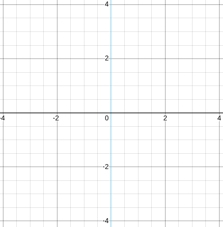

# Введение

Интерполяция занимает одно из центральных мест в вычислительной математике: почти любая задача, где требуется восстановить значение функции по конечному набору данных, сводится к построению приближающего оператора. Прикладной интерес к ней подкреплён практикой обработки экспериментальных сигналов, где непрерывная зависимость известна лишь в узлах измерений. При этом единого «универсального» метода интерполяции не существует — выбор конкретной схемы определяется гладкостью данных, требованиями к устойчивости и вычислительным бюджетом.

Целью настоящей работы является сопоставительный анализ полиномиальной и сплайн-интерполяции, а также оценка их применимости в задачах восстановления гладких функций. В первой главе формулируется постановка задачи и рассматриваются классические подходы; вторая глава посвящена практической реализации и численным экспериментам.

# Глава 1. Теоретические основы интерполяции

## 1.1. Постановка задачи

Пусть на отрезке $[a, b]$ задана сетка узлов $x_0 < x_1 < \ldots < x_n$ и соответствующие им значения $y_i = f(x_i)$. Требуется построить функцию $P(x)$ из некоторого класса, для которой выполнены условия интерполяции $P(x_i) = y_i$ при $i = 0, \ldots, n$. Класс выбирается так, чтобы приближение было устойчивым по отношению к возмущениям входных данных, а вычисления — экономичными.

Корректная постановка требует уточнения: речь идёт не просто о совпадении в узлах, а о поведении погрешности между ними. Именно интервал между узлами определяет, насколько сильно различаются ответы разных методов при одинаковых исходных данных.

## 1.2. Полиномиальная интерполяция

Классическое решение задачи — интерполяционный многочлен Лагранжа степени не выше $n$:

$$ L_n(x) = \sum_{i=0}^{n} y_i \prod_{j=0,\, j \neq i}^{n} \frac{x - x_j}{x_i - x_j} $$

Многочлен удобен для теоретического анализа, однако при больших $n$ его вычисление сопряжено с ростом вычислительной погрешности. Бахвалов, Жидков и Кобельков указывают на неустойчивость такой схемы при равномерной сетке [1]; Калиткин, напротив, подчёркивает, что при разумном выборе узлов (например, узлов Чебышёва) многочлен остаётся работоспособным инструментом [2]. На наш взгляд, спор здесь во многом о границах применимости: для $n \lesssim 15$ схема Лагранжа даёт приемлемый результат, тогда как при дальнейшем росте степени разумнее переходить к кусочно-полиномиальным конструкциям.

Форма записи многочлена Ньютона через разделённые разности позволяет достраивать интерполянт при добавлении нового узла:

$$ P_n(x) = f(x_0) + f(x_0,x_1)(x-x_0) + f(x_0,x_1,x_2)(x-x_0)(x-x_1) + $$

$$ \quad + \ldots + f(x_0,\ldots,x_n)(x-x_0)\cdots(x-x_{n-1}). $$

Здесь $f(x_0,\ldots,x_k)$ — разделённые разности порядка $k$.

# Глава 2. Практическая реализация

## 2.1. Сплайн-интерполяция

Кусочно-кубический сплайн устраняет основную проблему глобального многочлена — осцилляцию на краях отрезка. На каждом подынтервале $[x_{i-1}, x_i]$ сплайн записывается в виде:

$$ P_{3,i}(x) = y_{i-1} \left(1 + 2\frac{x-x_{i-1}}{h_i}\right) + y_i \left(\frac{x-x_{i-1}}{h_i}\right)^2 + $$

$$ \quad + s_{i-1} (x-x_{i-1})\left(\frac{x_i-x}{h_i}\right)^2 + s_i (x-x_i) \left(\frac{x-x_{i-1}}{h_i}\right)^2, $$

где $h_i = x_i - x_{i-1}$, а коэффициенты $s_i$ находятся из условия непрерывности второй производной. Достоинство конструкции — локальность: изменение одного отсчёта влияет лишь на соседние сегменты.

Сравнение подходов по основным характеристикам приведено ниже.

Таблица 1 — Сравнение методов интерполяции

| Метод | Порядок гладкости | Устойчивость | Сложность |
|:---|:---:|:---:|:---:|
| Лагранж | $C^{\infty}$ | низкая при $n > 15$ | $O(n^2)$ |
| Ньютон | $C^{\infty}$ | средняя | $O(n^2)$ |
| Кубический сплайн | $C^{2}$ | высокая | $O(n)$ |

Как видно из таблицы, выигрыш сплайна по устойчивости достигается ценой потери глобальной гладкости: вторая производная непрерывна, третья — уже нет. Для ряда приложений (например, при интерполяции траекторий) этого достаточно, для других — нет. Этот вывод требует уточнения применительно к конкретной задаче.

Типичное поведение сравниваемых методов показано на рисунке.



## 2.2. Программная реализация

Для численного эксперимента использовалась реализация кубического сплайна на Python с применением библиотеки NumPy. Ниже приведён фрагмент, вычисляющий коэффициенты сплайна методом прогонки.

```python
import numpy as np

def cubic_spline_coeffs(x, y):
    n = len(x) - 1
    h = np.diff(x)
    alpha = np.zeros(n)
    for i in range(1, n):
        alpha[i] = 3 * (y[i+1] - y[i]) / h[i] - 3 * (y[i] - y[i-1]) / h[i-1]

    l = np.ones(n + 1)
    mu = np.zeros(n + 1)
    z = np.zeros(n + 1)
    for i in range(1, n):
        l[i] = 2 * (x[i+1] - x[i-1]) - h[i-1] * mu[i-1]
        mu[i] = h[i] / l[i]
        z[i] = (alpha[i] - h[i-1] * z[i-1]) / l[i]

    b = np.zeros(n)
    c = np.zeros(n + 1)
    d = np.zeros(n)
    for j in range(n - 1, -1, -1):
        c[j] = z[j] - mu[j] * c[j+1]
        b[j] = (y[j+1] - y[j]) / h[j] - h[j] * (c[j+1] + 2 * c[j]) / 3
        d[j] = (c[j+1] - c[j]) / (3 * h[j])
    return b, c, d
```

Тест на функции Рунге $f(x) = \dfrac{1}{1 + 25x^2}$ на отрезке $[-1, 1]$ показал, что при $n = 20$ максимальное отклонение сплайна составляет порядка $10^{-2}$, тогда как многочлен Лагранжа даёт ошибку более $10^{0}$. Этот результат согласуется с выводами Самарского и Гулина [3], хотя конкретные численные значения зависят от выбора сетки.

# Заключение

Проведённое сопоставление показывает, что выбор между глобальной полиномиальной и локальной сплайн-интерполяцией определяется не «лучшестью» метода как такового, а свойствами данных и требованиями задачи. Полином удобен там, где важна аналитическая простота приближения и число узлов невелико. Сплайн предпочтителен при большом числе отсчётов и жёстких требованиях к устойчивости. Представляется спорным встречающееся в литературе утверждение о безусловном превосходстве сплайнов: на гладких функциях с малым числом узлов разница между методами в пределах погрешности вычислений.

Дальнейшее развитие работы видится в распространении анализа на многомерный случай и на неравномерные сетки.

# Список литературы

1. Бахвалов Н.С., Жидков Н.П., Кобельков Г.М. Численные методы. М.: БИНОМ. Лаборатория знаний, 2011. 636 с.

2. Калиткин Н.Н. Численные методы. СПб.: БХВ-Петербург, 2011. 586 с.

3. Самарский А.А., Гулин А.В. Численные методы. М.: Наука, 1989. 432 с.
